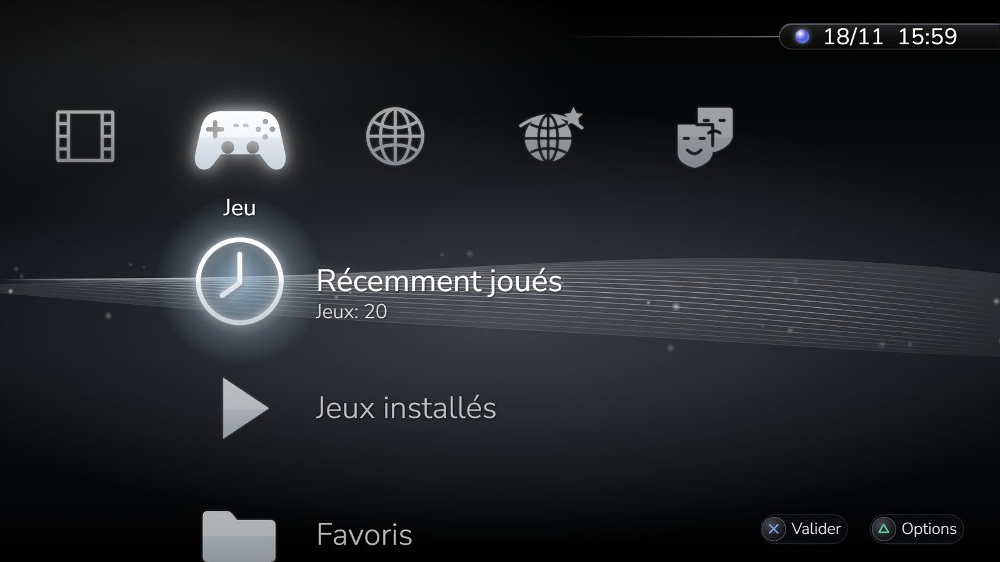
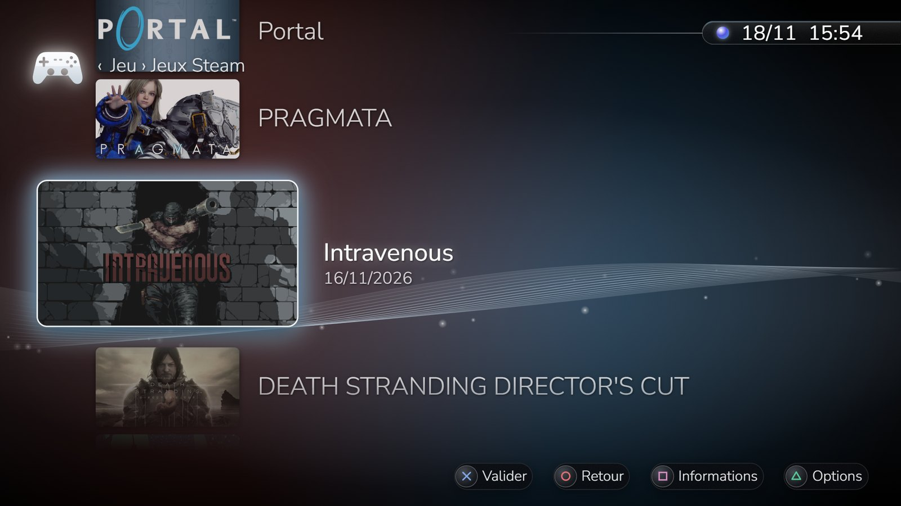

# PS3 XMB · Glass Dusk

**The PlayStation 3 interface for Steam**, on the smoked glass and dynamic colours of [Glass Dusk](https://github.com/Yareli0i/glass-dusk). A Millennium theme for the Steam desktop client **and Big Picture**: in Big Picture, the home screen becomes a real PS3 XMB menu.

**L'interface de la PlayStation 3 pour Steam**, sur le verre fumé et les couleurs dynamiques de Glass Dusk. Un thème Millennium pour Steam bureau **et Big Picture** : en Big Picture, l'accueil devient un vrai menu XMB PS3.

## English

- **Big Picture: a real XMB.** Categories (Users, Settings, Photo, Music, Video, Game, Network, Steam Network, Friends), controller navigation, Options (△) panel, PlayStation ✕○△□ or Xbox A B X Y glyphs, French / English / Russian.
- **Game column in the order it is used:** Recently played · Installed · Favourites · your collections · All games · Non-Steam · Downloads · Steam Library.
- **XMB side panels instead of Steam pages:** profile with status change, game information (play time, last session, size, reviews), downloads.
- **PS3 background everywhere:** the colour of the month (silver in January … red in December, dimmed in the evening) and the glowing XMB wave, on the desktop and in Big Picture. The wave always stays behind Steam and drifts smoothly on the GPU.
- **Game colours:** the selected game lends its art's colours (soft drifting colour fields, or its framed artwork). Back on a folder, the menu returns to the theme's neutral colours.
- **All of Glass Dusk** on the rest of Steam: library, store, menus, overlay, with its 36 settings.

**Install:** Millennium → Themes → Install, or copy this folder into `Steam/millennium/themes/`, then restart Steam. Settings: Millennium → Themes → PS3 XMB · Glass Dusk → ⋯ → Settings (tab **PS3**). The XMB's own settings are in its Settings category.

## Français

- **Big Picture : un vrai XMB.** Catégories PS3, navigation à la manette, panneau Options (△), symboles ✕○△□ ou A B X Y, français / anglais / russe.
- **Section Jeu dans l'ordre d'usage :** Récemment joués (5, 10 ou 20) · Jeux installés · Favoris · vos collections · Tous les jeux · Jeux non-Steam · Téléchargements · Bibliothèque Steam.
- **Panneaux XMB au lieu des pages Steam :** profil (statut modifiable), informations d'un jeu (temps de jeu, dernière session, taille, avis), téléchargements.
- **Fond PS3 partout :** couleur du mois, assombrie le soir, et vague XMB lumineuse, sur le bureau comme en Big Picture. La vague reste toujours derrière Steam et ondule de façon fluide.
- **Couleurs du jeu :** le jeu sélectionné prête ses couleurs (taches de couleur mouvantes ou image recadrée en fondu). De retour sur un dossier, le menu reprend les couleurs neutres du thème.
- **Glass Dusk complet** sur le reste de Steam, avec ses 36 réglages traduits en français.

**Installation :** Millennium → Thèmes → Installer, ou copiez ce dossier dans `Steam/millennium/themes/`, puis redémarrez Steam. Réglages : Millennium → Thèmes → PS3 XMB · Glass Dusk → ⋯ → Paramètres (onglet **PS3**).

## Steam Deck

The same XMB exists as a Decky Loader plugin for the Steam Deck: [LempereurTom/ps3-xmb](https://github.com/LempereurTom/ps3-xmb) (releases, full guide).

## Credits

- **Glass Dusk** by [Yareli](https://github.com/Yareli0i/glass-dusk) (MIT): this theme is built on it, all of its code and settings are kept. Its own README: [README.glass-dusk.md](README.glass-dusk.md). French translation of Glass Dusk by Warzox.
- **PSP XMB** by [Tim](https://github.com/timskap/psp-xmb) (MIT): the XMB the PS3 version grew from.
- Nunito Sans and JetBrains Mono: SIL OFL 1.1. Icons are original drawings; no PlayStation logo or Sony asset is included.
- Source, tests and issues: [LempereurTom/ps3-xmb](https://github.com/LempereurTom/ps3-xmb).
